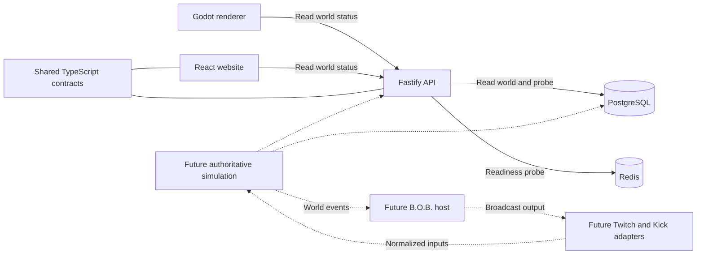

# Architecture

The TypeScript backend owns world state. The HTTP application reads world metadata from PostgreSQL through Prisma; no simulation loop exists in v0.1A. The world status service separates persistence from the HTTP route so the engine can supply runtime fields in v0.1D without making clients authoritative.

- **Persistent storage:** `World`, `WorldSettings`, and `SystemEvent` establish the data boundary. Redis is probed for readiness only. It does not store world state or carry events yet.
- **Simulation:** The server returns persisted identity and status, with zero citizens and no world time until those systems exist. Renderer, web, stream, and AI availability must not drive the future simulation clock.
- **Godot:** A native HTTP client displays a read-only status and keeps its scene available offline. It neither advances nor saves the world.
- **Web:** A same-origin HTTP client validates responses against `packages/shared`. Vite proxies API traffic during development and preview. A deployed static build needs a reverse proxy for `/api`.
- **Future adapters and host:** Stream adapters will translate platform events into domain inputs. B.O.B. will consume world events for presentation. Neither belongs in the simulation's persistence or tick path.
